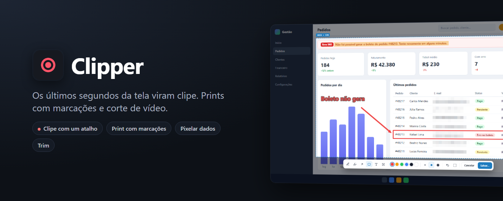
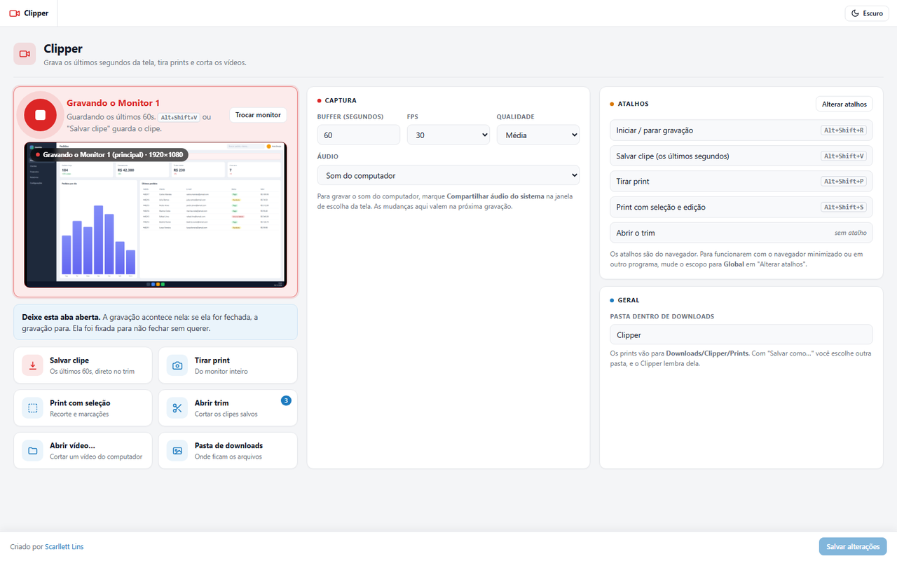
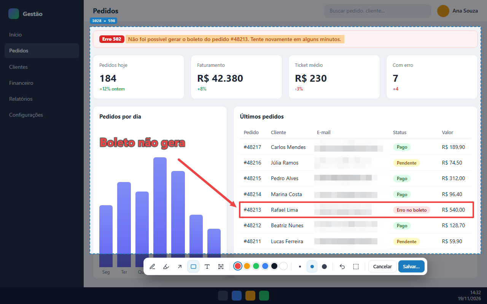
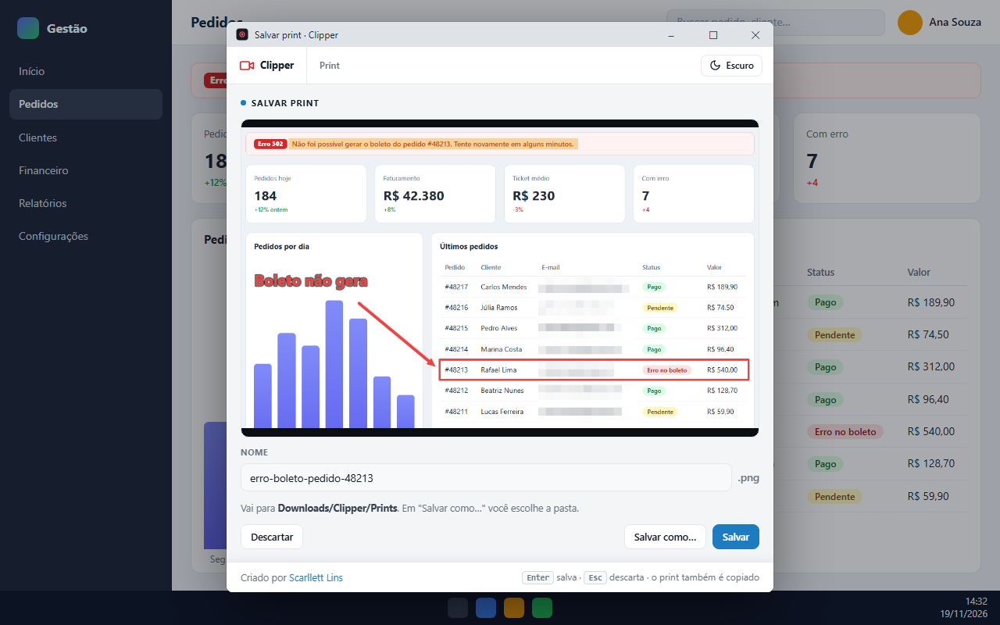
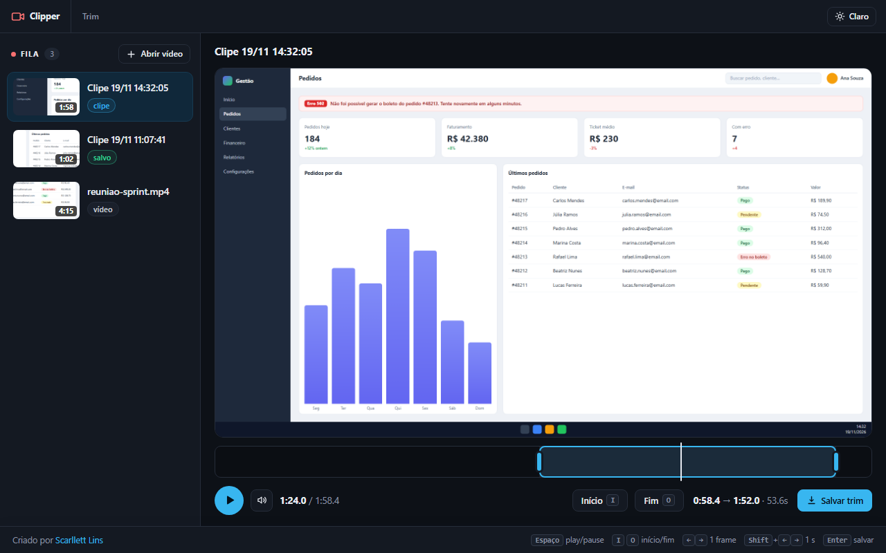
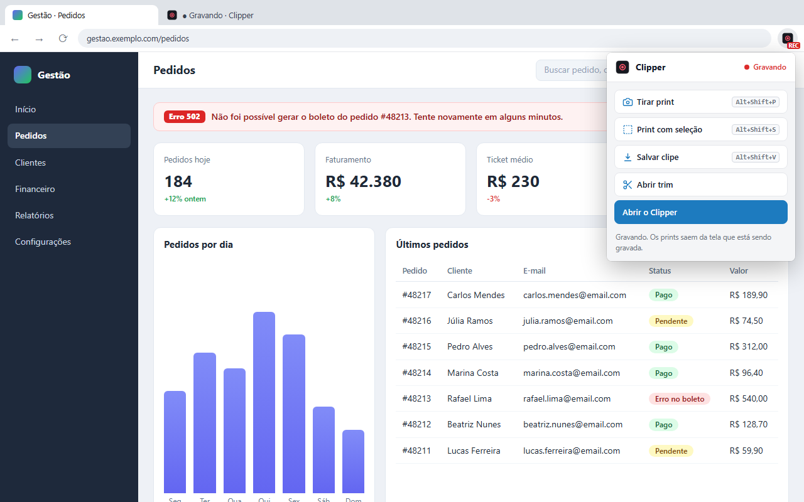

# Clipper



Extensão para o **Google Chrome** que grava continuamente os últimos segundos da tela. Quando algo importante
acontece, um atalho salva esse trecho como clipe, sem precisar ter começado a gravar antes. Também tira prints com
marcações e corta vídeos, tudo dentro do navegador, sem instalar nenhum programa.

Tudo acontece no seu computador: o Clipper não tem servidor e não envia nenhum dado. Veja a
[Política de Privacidade](PRIVACIDADE.md).

## O que ele faz

**Clipe dos últimos segundos.** Ligue a gravação uma vez e o Clipper guarda sempre os últimos segundos da tela (de 5 a
600, você escolhe). Aconteceu um erro ou um bug? Aperte `Alt+Shift+V` e o trecho vai direto para o trim.



**Print com seleção e marcações.** Escolha a área e marque com caneta, marca-texto, seta, retângulo e texto, ou
**pixele** dados sensíveis antes de compartilhar.



**Print do monitor inteiro.** Dê um nome e salve. O print também vai para a área de transferência (`Ctrl+V`).



**Trim.** Marque o início e o fim (`I` e `O`) e salve. Funciona com os clipes do Clipper e com vídeos do computador
(MP4 e WebM). Salva em MP4 quando o navegador permite.



**Menu do ícone.** As ações principais a um clique.



## Atalhos

| Ação | Atalho padrão |
|---|---|
| Iniciar / parar a gravação | `Alt+Shift+R` |
| Salvar clipe (os últimos segundos) | `Alt+Shift+V` |
| Tirar print | `Alt+Shift+P` |
| Print com seleção e edição | `Alt+Shift+S` |

Os atalhos podem ser trocados em `chrome://extensions/shortcuts`. Para funcionarem com o navegador minimizado ou em
outro programa, mude o escopo do atalho para **Global** nessa página.

## Instalar

### Pela Chrome Web Store

*(link em breve)*

### Pelo código (modo desenvolvedor)

1. Baixe este repositório (**Code → Download ZIP**) e descompacte.
2. Abra `chrome://extensions` e ligue o **Modo do desenvolvedor**.
3. Clique em **Carregar sem compactação** e escolha a pasta **`extensao`**.
4. Fixe o ícone do Clipper na barra do navegador (ícone de quebra-cabeça → alfinete).

## Como usar

- **Gravar:** abra o Clipper (ícone → *Abrir o Clipper*), clique no botão vermelho e escolha o monitor na janela do
  Chrome. Para gravar o som do computador, marque *Compartilhar áudio do sistema*. O atalho `Alt+Shift+R` faz o
  mesmo. **Deixe a aba do Clipper aberta**: a gravação acontece nela (ela é fixada sozinha).
- **Clipe:** com a gravação ligada, o atalho (ou o botão *Salvar clipe*) guarda os últimos segundos e abre o trim,
  com o final já marcado.
- **Print:** é sempre do monitor inteiro. Com a gravação ligada, sai do monitor gravado sem perguntar nada. Sem
  gravação, o Chrome pergunta qual monitor. *Salvar* manda para `Downloads/Clipper/Prints`, e *Salvar como…*
  deixa escolher a pasta.
- **Print com seleção:** arraste para escolher a área e use as ferramentas de marcação. `Enter` salva e `Esc`
  cancela.

## Limitações do navegador

Por segurança, o Chrome impõe algumas regras a qualquer extensão que captura a tela:

- O Chrome pede para você escolher a tela **a cada gravação**. Nenhuma extensão pode gravar sem essa confirmação.
- Enquanto grava, aparece a barra "compartilhando a tela" do Chrome.
- Salvar um trim leva o mesmo tempo que o trecho dura, porque o navegador regrava o vídeo.
- O trim abre só os formatos que o navegador toca (MP4 H.264 e WebM).
- O buffer fica na memória: um buffer muito longo em qualidade alta pesa.

## Estrutura do código

```
extensao/
  manifest.json       configuração da extensão (permissões, atalhos, ícones)
  background.js       recebe os atalhos e as ações do menu do ícone e chama a página certa
  icones/             ícones da extensão
  comum/
    base.css          estilo comum
    tema-inicial.js   aplica o tema claro/escuro antes da página desenhar
    interface.js      tema, avisos (toast), links e registro de erros
    config.js         configurações padrão e salvas
    db.js             banco local: fila de vídeos e prints
    janelas.js        abre/foca as páginas (painel, trim, salvar, seleção)
    monitores.js      escolha da tela e em qual monitor ela está
    gravador.js       gravação contínua do monitor (buffer)
    midia.js          duração, miniatura e exportação do trecho do trim
    util.js           nomes de arquivo, datas, downloads, notificações
  paginas/
    painel.*          janela principal: gravar, ações e configurações (a gravação roda aqui)
    popup.*           menu do ícone da extensão
    trim.*            tela de trim
    capturar.*        print sem gravação: pede a tela e tira um quadro dela
    salvar.*          janela de salvar print
    selecao.*         print com seleção e edição
docs/imagens/         imagens deste README
```

Sem dependências e sem etapa de build: o código da pasta `extensao` é exatamente o que roda no navegador.

### Como funciona o buffer

O navegador não deixa emendar pedaços soltos de vídeo sem recodificar, então rodam **dois gravadores defasados**.
Cada um recomeça quando passa de 2× o buffer, mas só se o outro já tiver pelo menos 1× o buffer. Assim sempre existe
um gravador com os últimos N segundos inteiros, e o clipe sai num arquivo só. O trim já abre com os últimos N
segundos marcados.

## Privacidade

O Clipper não coleta nem envia dados. Gravações, prints e configurações ficam apenas no seu computador. Detalhes na
[Política de Privacidade](PRIVACIDADE.md).

## Problemas e sugestões

Abra uma *issue* na aba **Issues** deste repositório.

---

Criado por [Scarllett Lins](https://github.com/scarllettlins).
